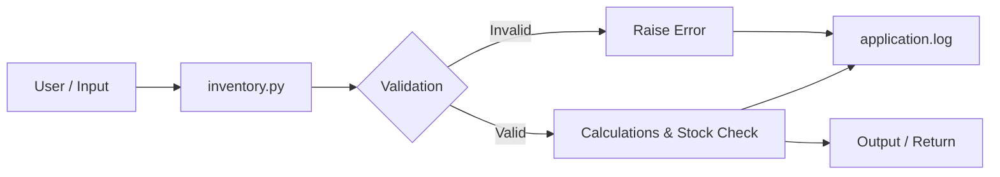
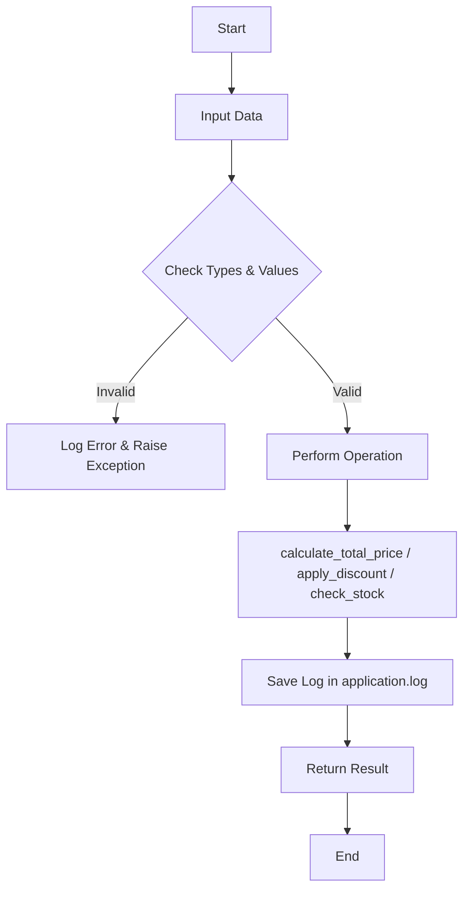

# Assignment 10 – Product Inventory Management System

A Python program to manage inventory calculations, input validations, logging, and unit testing.

---

## 🏗️ System Flow & Architecture

### Simple Architecture Diagram


### Simple End-to-End Flow


---

## 📋 Features

1. **`calculate_total_price(price, quantity)`**: Calculates total price (`price * quantity`).
2. **`apply_discount(total, discount_percent)`**: Calculates discounted price.
3. **`check_stock(available_stock, requested_quantity)`**: Checks stock availability (`True` / `False`).
4. **Exception Handling**: Rejects invalid types (`TypeError`) and negative/out-of-range values (`ValueError`).
5. **Logging**: Logs operations, warnings, and errors to `application.log`.
6. **Unit Tests & Code Quality**: Tested with `pytest` (12 tests) and formatted with `Ruff`.

---

## 📸 Screenshots

### 1. Pytest Test Results


### 2. Ruff Checks


---

## 📁 Project Structure

```text
product-inventory-management/
├── .gitignore
├── README.md
├── application.log
├── inventory.py
├── test_inventory.py
└── sreenshots/
    ├── 1. Pytest.png
    ├── 2. Ruff Checks.png
    └── 2.1. ruff check.png
```

---

## 💻 Setup & Run (macOS)

### 1. Setup Environment
```bash
python3 -m venv .venv
source .venv/bin/activate
pip install pytest ruff
```

### 2. Run Application
```bash
python3 inventory.py
```

### 3. Run Tests
```bash
pytest -v
```

### 4. Run Ruff Checks
```bash
ruff check .
ruff format --check .
```
