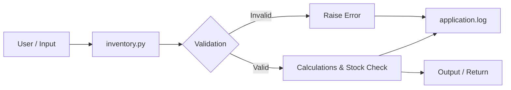
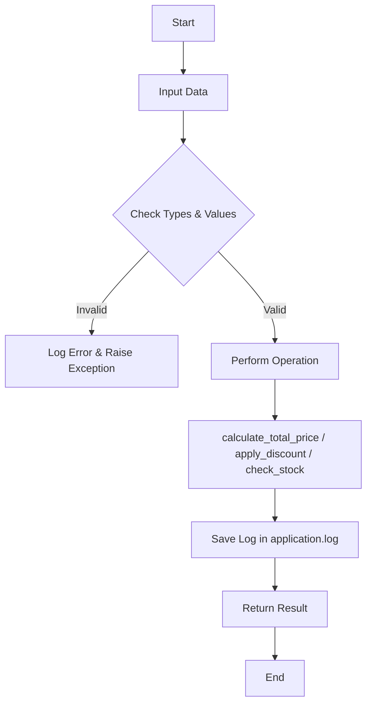

# Assignment 10 – Product Inventory Management System

---

## 📌 Student & Course Details

- **Student Name:** Shivam
- **Course:** Python Programming
- **Topic:** Assignment 10 – Product Inventory Management System
- **Repository:** [Assignment-10-Product-Inventory-Management-System](https://github.com/shivamg-ops/Assignment-10-Product-Inventory-Management-System)
- **Environment:** macOS / Python 3.10+

---

## 📖 Project Overview

This project is a simple and reliable **Product Inventory Management System** written in Python. It handles product calculations, stock validation, logging, and error handling. It is fully tested with `pytest` and formatted using `Ruff`.

---

## 🏗️ System Flow & Architecture

### Simple Architecture


### Simple End-to-End Flow


---

## 📋 Features Implemented

1. **`calculate_total_price(price, quantity)`**
   - Calculates the total cost (`price * quantity`).
   - Validates that price and quantity are positive numbers.
   - Raises `ValueError` for negative values and `TypeError` for invalid data types.

2. **`apply_discount(total, discount_percent)`**
   - Applies discount percentage to the total amount.
   - Validates that discount is between `0%` and `100%`.
   - Raises `ValueError` if discount is outside this range.

3. **`check_stock(available_stock, requested_quantity)`**
   - Checks if sufficient stock is available.
   - Returns `True` if stock is available, otherwise `False`.
   - Logs a warning if stock is insufficient.

4. **Exception Handling & Logging**
   - Catches invalid inputs with proper exceptions (`TypeError`, `ValueError`).
   - Saves all operations, errors, and warnings into `application.log`.

5. **Testing & Code Quality**
   - Tested using **pytest** with 12 unit tests covering all valid and edge cases.
   - Formatted and linted using **Ruff** for clean code quality.

---

## 📸 Screenshots

### 1. Pytest Test Results


### 2. Ruff Quality & Format Checks


---

## 📁 Project Structure

```text
product-inventory-management/
├── .gitignore             # Ignores .venv and cache files
├── README.md              # Project documentation
├── application.log        # Generated log file
├── inventory.py           # Main inventory logic
├── test_inventory.py      # Unit tests
└── sreenshots/            # Verification screenshots
    ├── 1. Pytest.png
    ├── 2. Ruff Checks.png
    └── 2.1. ruff check.png
```

---

## 💻 Setup & Run Instructions (macOS)

### 1. Create Virtual Environment
```bash
python3 -m venv .venv
source .venv/bin/activate
```

### 2. Install Required Packages
```bash
pip install pytest ruff
```

### 3. Run the Program
```bash
python3 inventory.py
```
**Output:**
```text
Total Price: 150.0
After Discount: 135.0
Stock Available: True
```

### 4. Run Unit Tests
```bash
pytest -v
```

### 5. Run Ruff Linting & Formatting
```bash
ruff check .
ruff format --check .
```
