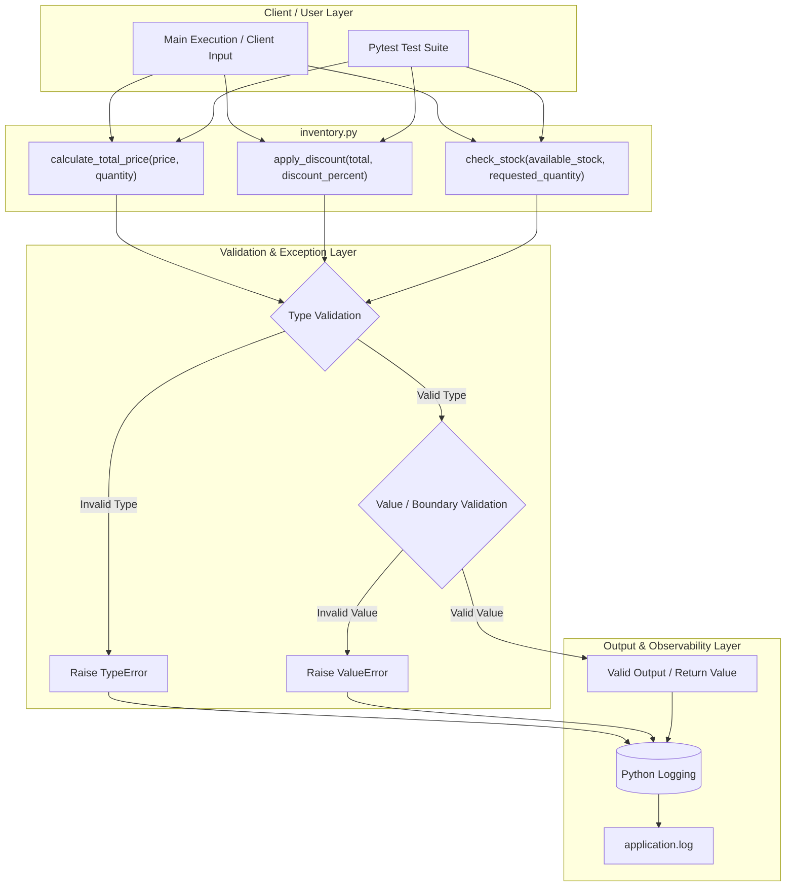
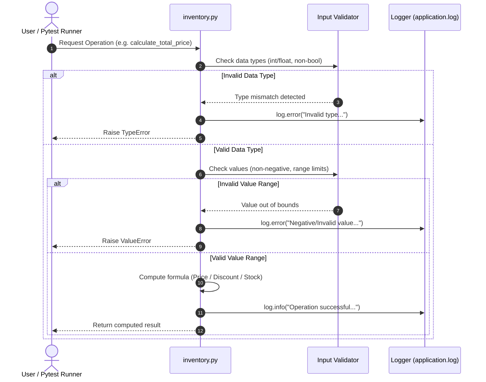

# Assignment 10 – Product Inventory Management System

A Python-based Product Inventory Management System designed to handle core inventory calculations, strict input validation, exception handling, automated unit testing, logging, and code quality formatting.

---

## 🏗️ System Architecture & End-to-End Flow

### 1. High-Level Architecture


---

### 2. End-to-End Workflow Diagram


---

## 📋 Features Implemented

1. **Total Price Calculation (`calculate_total_price`)**:
   - Computes total cost based on price and quantity.
   - Validates numeric inputs and rejects negative values or boolean types.
   - Logs operations and calculation outcomes.

2. **Discount Calculation (`apply_discount`)**:
   - Calculates discounted amount based on percentage (0% to 100%).
   - Validates that discount falls strictly within standard percentage limits.
   - Raises appropriate exceptions on negative totals or out-of-range discounts.

3. **Stock Availability Checking (`check_stock`)**:
   - Checks if inventory can fulfill requested quantity.
   - Returns boolean (`True` / `False`).
   - Ensures requested quantity is positive ($> 0$) and available stock is non-negative ($\ge 0$).
   - Records warnings when stock is insufficient.

4. **Logging System**:
   - Uses standard Python `logging`.
   - Records timestamps, log levels (`INFO`, `WARNING`, `ERROR`), and detailed messages to `application.log`.

5. **Testing & Code Quality**:
   - 12 comprehensive unit tests using `pytest` covering normal inputs, edge boundaries, and exceptions.
   - Linted and auto-formatted using `Ruff` with zero warnings.

---

## 📸 Test Execution & Linting Screenshots

### 1. Pytest Test Suite Execution
All unit tests executed and passed successfully across all functions:


### 2. Ruff Quality Checks & Formatting
Ruff code analysis and format checks passing cleanly:


---

## 📁 Project Structure

```text
product-inventory-management/
├── .gitignore             # Configured to ignore .venv, cache, and OS artifacts
├── README.md              # Project documentation, diagrams, and setup instructions
├── application.log        # Generated runtime log file
├── inventory.py           # Core implementation logic
├── test_inventory.py      # Pytest test suite
└── sreenshots/            # Execution and verification screenshots
    ├── 1. Pytest.png
    ├── 2. Ruff Checks.png
    └── 2.1. ruff check.png
```

---

## 💻 macOS Setup Instructions

### 1. Prerequisites
Ensure Python 3.10 or higher is installed:
```bash
python3 --version
```

### 2. Clone the Repository
```bash
git clone https://github.com/shivamg-ops/Assignment-10-Product-Inventory-Management-System.git
cd Assignment-10-Product-Inventory-Management-System
```

### 3. Create and Activate Virtual Environment
```bash
python3 -m venv .venv
source .venv/bin/activate
```

### 4. Install Dependencies
```bash
pip install pytest ruff
```

---

## 🚀 Execution Instructions

Run the main application:
```bash
python3 inventory.py
```

### Expected Output
```text
Total Price: 150.0
After Discount: 135.0
Stock Available: True
```

Inspect generated logs:
```bash
cat application.log
```

---

## 🧪 Testing Instructions

Run the pytest test suite:
```bash
pytest -v
```

### Test Coverage Summary
- `calculate_total_price`: Valid inputs, zero value boundary, negative value errors, invalid types.
- `apply_discount`: Valid discounts, 0% and 100% boundaries, out-of-range percentage, negative total errors.
- `check_stock`: Available stock, insufficient stock, non-positive requested quantity, invalid types.

---

## 🔍 Code Quality Instructions (Ruff)

Check linting:
```bash
ruff check .
```

Check code formatting:
```bash
ruff format --check .
```
